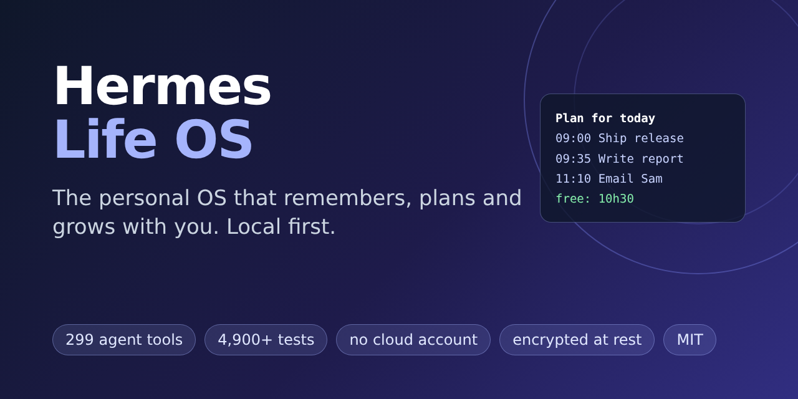
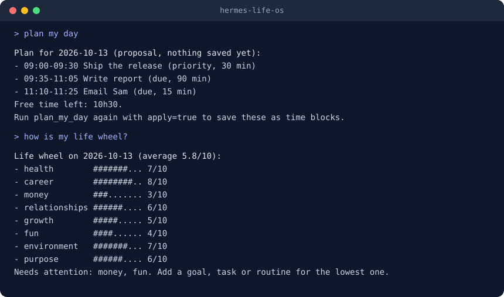
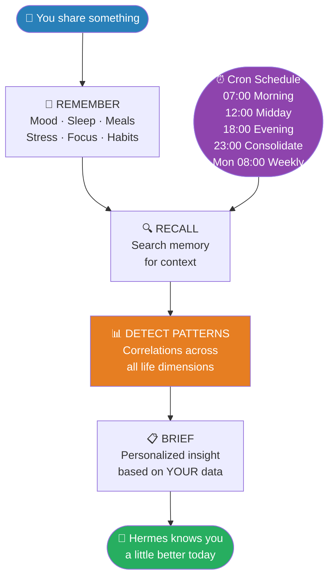
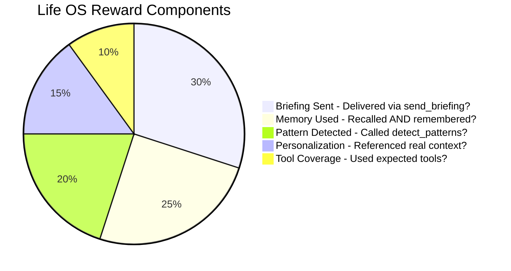
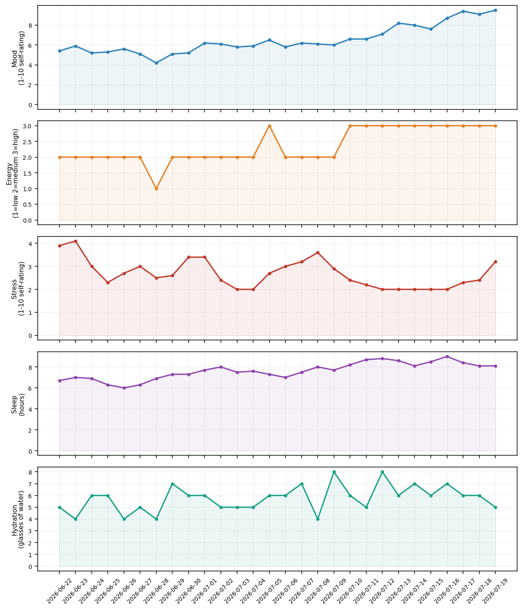

<p align="center">
  
</p>

# Hermes Life OS 🧠

[](https://github.com/Lethe044/hermes-life-os/actions/workflows/tests.yml)
[](https://pypi.org/project/hermes-life-os/)
[](https://pypi.org/project/hermes-life-os/)
[](LICENSE)
[](https://github.com/Lethe044/hermes-life-os/stargazers)
[](https://github.com/Lethe044/hermes-life-os/commits/main)

**The personal OS that grows with you.** Track how you feel, plan your day, keep your life
organised, and let an agent connect the dots. Local first, encrypted if you want, no account needed.

[Quick start](#quick-start) · [Tool reference](docs/TOOLS.md) · [Command line](docs/CLI.md) · [Changelog](CHANGELOG.md) · [Contributing](CONTRIBUTING.md) · [Security](SECURITY.md)

> Built for the NousResearch "Show us what Hermes Agent can do" hackathon.

## Quick Tour

Ask in plain language; Hermes calls the right tool and answers from your own data.

<p align="center">
  
</p>

| You want to | Say something like | Tool |
| --- | --- | --- |
| Pick today's focus | "my top three today are the report, the gym and calling mum" | `add_priority` |
| Get a plan | "plan my day" | `plan_my_day` |
| Check in on your life | "rate my health 7 and money 3" | `log_life_wheel` |
| Keep a backlog | "add Dune to my books" | `add_library_item` |
| Use your own calendar app | "export my calendar" | `export_calendar` |
| Empty your head | "remind me to look into cello lessons" | `add_to_inbox` |
| Close the week | "start my weekly review" | `start_weekly_review` |
| Learn something for good | "quiz me on my Spanish cards" | `review_flashcards` |
| See the money picture | "what is my net worth?" | `get_net_worth` |
| Move a big goal forward | "start a project: launch the website" | `add_project` |
| Stop forgetting follow-ups | "I am waiting for a quote from the plumber" | `add_waiting` |
| Undo a mistake | "put the rent task back" | `restore_deleted` |
| Understand yourself | "what affects my sleep?" | `get_correlations` |

All 299 tools are listed in the [tool reference](docs/TOOLS.md).

## Contents

- **Start here:** [What it does](#what-it-does) · [Architecture](#architecture) · [Quick start](#quick-start) · [Chat mode](#chat-mode)
- **Your data:** [Encryption](#encryption-at-rest-optional) · [Automatic backups](#automatic-backups) · [Restore](#restore) · [Health check](#health-check-doctor) · [Data export](#data-export)
- **Planner:** [Tasks, agenda](#planner-tasks-body-metrics-subscriptions-people--todays-agenda) · [Priorities, plan my day, life wheel, library](#daily-priorities-plan-my-day-life-wheel-library--calendar-export) · [Inbox, weekly review](#inbox--weekly-review) · [Flashcards, net worth](#flashcards--net-worth) · [Projects, waiting for](#projects--waiting-for) · [Time blocks, objectives, recipes, trips](#time-blocks-objectives-recipes--trips) · [Chores, routines, decisions](#chores-expiry-dates-routines-gift-ideas--decisions) · [Recently deleted](#recently-deleted-recommendation-ledger--pinned-backups)
- **Insights:** [Pattern detection](#pattern-detection) · [Life review](#life-review---the-flagship-retrospective-report) · [Dashboard](#dashboard)
- **Connect:** [Telegram](#telegram-bot) · [Discord](#discord-bot) · [Slack](#slack-bot) · [Local REST API](#local-rest-api) · [Plugins](#plugin-system-add-your-own-tools-no-fork-required)
- **Project:** [Project structure](#project-structure) · [What's new](#whats-new) · [Running tests](#running-tests)

## What It Does

Tell it how you feel. Log what you ate. Track your sleep.
Over time it starts connecting dots you haven't: energy crashes after poor sleep,
mood dips on low-hydration days, focus drops when stress spikes.
Every morning it briefs you. Every evening it reflects with you.
Every week it tells you what the data says about your life.

**The longer you use it, the more it knows. The more it knows, the more useful it becomes.**

## Architecture



## Hermes Features Used

| Feature | How It's Used |
|---------|--------------|
| **Memory** | Stores every mood, meal, sleep entry, workout, stress log - recalls before every response |
| **Skills** | Life OS playbook defines daily rhythm, pattern detection rules, and briefing format |
| **Cron** | Automated briefings at 07:00, 12:00, 18:00, 23:00, and weekly Monday reviews |
| **Gateway** | Delivers briefings via terminal - extensible to Telegram, email, SMS |
| **Subagents** | Pattern detection runs across all health dimensions in parallel |
| **Atropos RL** | Reward function trains Hermes to be more personal and memory-driven over time |

## Tracking Capabilities

| Category | What Hermes Tracks |
|----------|-------------------|
| 🥗 Nutrition | Meals, calories, protein/carbs/fat, daily totals |
| 😴 Sleep | Duration, quality score, 7-day averages |
| 💧 Hydration | Daily water intake with progress bar |
| 💪 Fitness | Workouts, duration, intensity, weekly count |
| 🧘 Mental | Stress levels, meditation sessions, gratitude logs |
| 🎯 Focus | Deep work sessions, distractions, quality scores |
| ✅ Habits | Streaks, best streaks, completion tracking |
| 🎯 Goals | Progress percentages, milestones, notes |
| 😊 Mood & Energy | Daily scores, trend detection, dip alerts |
| 💰 Spending | Expenses by category, daily/period totals |
| 🤝 Social | Time connecting with others, quality, trend |
| ☕ Substances | Caffeine, alcohol, or anything else - amount, frequency |
| 📚 Reading | Sessions, minutes, pages, titles |
| 💊 Medication | Dose taken/skipped, adherence % by medication |

## Pattern Detection

Hermes automatically detects and surfaces:
- Mood dips lasting 3+ consecutive days
- Sleep deprivation affecting focus and mood
- Energy crashes correlated with nutrition gaps
- Stress spikes and their triggers
- Habit streaks worth celebrating
- Goal stalls that need a nudge
- Hydration gaps on high-stress days

### Correlation Engine

`demo/analytics.py` computes real Pearson correlation coefficients between
tracked metrics (mood, sleep, stress, energy, hydration) using daily-averaged
values from memory. A pair is only surfaced when there's enough data
(4+ overlapping days by default) and the relationship is meaningful
(|r| >= 0.4). Each result reports the direction (positive/negative), strength
(weak/moderate/strong), and the number of days behind it - no external
dependencies required (pure Python stdlib).

**Lagged (predictive) correlations:** same-day correlation can't tell you
whether poor sleep caused today's low mood, or whether being stressed
already caused last night's poor sleep - it just says the two move
together. `compute_lagged_correlations()` shifts one metric forward by
1-2 calendar days (correctly handling gaps from unlogged days) before
correlating, which at least points the arrow of time forward: "a higher
X on one day tends to be followed by a higher/lower Y N days later."
Both same-day and lagged results feed every surface that already shows
insights (chat replies, `detect_patterns`, the static and live
dashboards, the weekly email) automatically, plus a dedicated
`get_correlation_insights` tool for a deeper, on-demand analysis over
a custom day range - just ask "what patterns have you noticed in my
data?" or "what predicts my mood?".

## Reward Function



## Quick Start

Works with four LLM backends - pick whichever you already have. The
provider is auto-detected from whatever key is set (or force one with
`--provider`).

```bash
pip install "hermes-life-os[all]"

# Option A - free, fully local, no API key:
ollama serve
ollama pull llama3.1

# Option B / C / D - pick one:
set ANTHROPIC_API_KEY=sk-ant-...
set OPENAI_API_KEY=sk-...
set OPENROUTER_API_KEY=sk-or-...

hermes-life-os --mode onboard
hermes-life-os --mode morning
hermes-life-os --mode chat

# force a specific backend regardless of which keys are set:
hermes-life-os --mode morning --provider anthropic
```

Prefer running from source instead of installing? Clone the repo and use
`python demo/demo_life_os.py ...` in place of `hermes-life-os ...` above
(same flags, same behavior) - see [Project Structure](#project-structure).

### Use it without an AI model

Every tool also runs straight from the shell, with no language model and no API key:

```bash
hermes-life-os-tool run add_task text="Pay rent" due=friday priority=high
hermes-life-os-tool run plan_my_day
hermes-life-os-tool list --match calendar
```

See [docs/CLI.md](docs/CLI.md) for arguments, scripting and cron examples.

### Or run it with Docker - zero Python setup

```bash
# pull the pre-built image - no clone needed:
docker run --rm -it -e ANTHROPIC_API_KEY=sk-ant-... \
    -v hermes-life-os-data:/root/.hermes \
    ghcr.io/lethe044/hermes-life-os:latest --mode morning
```

Or build it yourself, and get a fully free trial paired with a local
Ollama container (no API key at all):

```bash
git clone https://github.com/Lethe044/hermes-life-os.git
cd hermes-life-os

docker compose up -d ollama
docker compose exec ollama ollama pull llama3.1
docker compose run --rm hermes-life-os --mode onboard
```

## All Demo Modes

| Mode | What Happens |
|------|-------------|
| `onboard` | First-time setup - Hermes learns who you are |
| `morning` | Daily briefing based on all your patterns |
| `checkin` | Midday log - mood, habits, quick nudge |
| `evening` | Evening reflection - wins, struggles, patterns |
| `weekly` | Sunday review - what this week says about you |
| `nutrition` | Log meals and get nutrition insights |
| `sleep` | Log sleep and get sleep analysis |
| `fitness` | Log workouts and track fitness patterns |
| `mental` | Log stress, meditation, and gratitude |
| `focus` | Log deep work sessions and productivity |
| `health` | Full health dashboard - all data in one view |
| `dream` | **Dream journal** - log dreams, detect patterns, sleep/stress correlation |
| `chat` | **Interactive conversation** - type anything |

## Chat Mode

```bash
python demo/demo_life_os.py --mode chat
```

Type naturally. Hermes responds using everything it knows about you.
Type `exit` to leave.

Example conversations:
- "I feel stressed today, any advice?"
- "Log my lunch - grilled chicken and rice, about 600 calories"
- "How has my sleep been this week?"
- "I just ran 5km, log it"
- "What patterns are you seeing in my data?"
- "I logged 4 hours of sleep by mistake, it was actually 7" - Hermes recalls
  the entry and corrects it
- "Delete that last mood entry, I misclicked" - Hermes finds and removes it
  (asks for confirmation first)
- "Set a goal to sleep 7+ hours a night" - Hermes tracks this automatically
  from your actual logged sleep, no manual progress updates needed
- "How am I doing on my goals?" / "How does this week compare to last week?"
- "Has anything been unusual lately?" / "How was I in March?"

## Multi-Profile (shared households)

```bash
python demo/demo_life_os.py --mode morning --profile alex
python demo/dashboard.py --profile alex
```

By default everything lives at `~/.hermes/life-os/` (unchanged, single
person). Passing `--profile <name>` (or setting `LIFE_OS_PROFILE`) fully
isolates that person's data under `~/.hermes/life-os/profiles/<name>/` -
so a household can share one install without mixing anyone's mood/sleep/
habit data. Omitting `--profile` always keeps working exactly as before.

## Multi-User (real accounts for the local API & Slack bot)

```bash
python demo/users.py add alex --profile alex --role owner
python demo/users.py add sam  --profile sam
python demo/users.py list
```

Profiles isolate data; this registry is what turns a profile into a
*person who can log in*. Each user gets their own API key (shown once,
stored only as a salted PBKDF2 hash) that resolves to their own profile
automatically - so a whole household or small team can share one running
`hermes-life-os-api` server or one Slack bot, and everyone only ever
sees their own data:

```bash
curl -H "X-API-Key: <alex's key>" http://127.0.0.1:8765/api/health
# {"status": "ok", "profile": "alex", "user": "alex"}
```

Fully opt-in and non-breaking - a single `LIFE_OS_API_KEY`/`--profile`
keeps working exactly as before if you never touch `users.py`. Full
setup, including linking a user to their Slack account, in
[docs/MULTI_USER.md](docs/MULTI_USER.md).

## Plugin System (add your own tools, no fork required)

```bash
mkdir -p ~/.hermes/life-os/plugins
cp demo/plugins_examples/dice.py ~/.hermes/life-os/plugins/
python demo/demo_life_os.py --mode chat
# "roll a d20 for me"
```

Drop a `.py` file defining a `TOOLS` list and a `dispatch(name, inp)`
function into `~/.hermes/life-os/plugins/`, and Hermes' LLM agent can
call it like any built-in tool - next start, no core code changes. A
broken plugin is skipped and reported, never crashes the app; a plugin
can't shadow a built-in tool name. `python demo/plugins.py` lists
everything currently loaded. Two ready-to-copy examples ship in
`demo/plugins_examples/` (a dependency-free dice/coin-flip tool, and a
profile-aware screen-time tracker showing how to persist your own data).
Full plugin API and a "share it with others" guide in
[docs/PLUGINS.md](docs/PLUGINS.md).

## Encryption at Rest (optional)

```bash
set LIFE_OS_ENCRYPTION_KEY=your-passphrase-here
python demo/demo_life_os.py --mode morning
```

Off by default - nothing changes unless you set this. When set, every
data file (profile, habits, goals, nutrition, sleep, etc.) and every line
of `memory.jsonl` is encrypted at rest with a key derived from your
passphrase (PBKDF2-HMAC-SHA256 + Fernet/AES). Existing plaintext data is
read transparently and gets encrypted the next time it's written - no
separate migration step. **There is no password recovery** - if you lose
the passphrase, that data is unrecoverable by design. Requires
`pip install "hermes-life-os[encryption]"` (or `pip install cryptography`
if running from source).

**Changing your passphrase:** use `hermes-life-os-rekey` rather than
just setting a new `LIFE_OS_ENCRYPTION_KEY` - the latter would leave
your existing files encrypted under the *old* key, unreadable. The
re-key tool decrypts everything with the old key, rotates the salt, and
re-encrypts everything with the new one in one step (it also works to
enable encryption for the first time, or disable it entirely):

```bash
hermes-life-os-backup                                    # back up first
hermes-life-os-rekey --old-key "old pass" --new-key "new pass"
hermes-life-os-rekey --new-key "new pass"                # enable for the first time
hermes-life-os-rekey --disable                           # decrypt everything back to plaintext
```

As of v1.38.0 re-keying covers every data store (spending, social,
substance, reading, medication, achievements, templates, budgets and
reminders as well as the original nine). Before that fix it only
re-encrypted nine files, so after a passphrase change the others could no
longer be decrypted and silently read back as empty. Backups written while
a passphrase is set are encrypted too (see "Automatic Backups").

## Time Blocks, Objectives, Recipes & Trips

Five more stores plus three read-only helpers, all local, per profile,
encrypted with the rest of your data when encryption is on, and covered by
backup, restore, export and the doctor.

```
"block 9 to 10:30 tomorrow for deep work"   "when am I free for 45 minutes?"
"schedule the report task this week"        "how did I spend my week?"
"objective for Q4: run 100 km"              "I ran 12 km today"
"save my lentil soup recipe"                "plan soup for dinner on Friday"
"make a shopping list from the meal plan"   "trip to Rome Nov 1 to Nov 4"
"what triggers my headaches?"               "find everything about Rome"
```

- **Time blocks** (`add_time_block`, `get_day_plan`, `update_time_block`,
  `delete_time_block`, `finish_time_block`, `find_free_time`, `schedule_task`,
  `get_time_allocation`): put work on the clock. Overlaps are refused, the day
  plan shows blocks and free gaps (07:00 to 22:00), `find_free_time` lists the
  first free slots, `schedule_task` places a task in the first slot that fits
  and the allocation report shows where the hours went by category. Finishing a
  block can complete its task. A block starting within 15 minutes is nudged.
- **Objectives and key results** (`add_objective`, `add_key_result`,
  `record_key_result`, `get_okrs`, `update_okr`, `delete_okr`): an objective for
  a week, month, quarter (`2026-Q4`) or year with measurable key results
  (upward or downward targets). Progress is compared with the share of the
  period that has passed: ahead of pace, on track, slightly behind or behind.
  Objectives ending within a week below 70% are nudged and shown in the agenda.
- **Recipes and meal plan** (`add_recipe`, `get_recipes`, `get_recipe`,
  `update_recipe`, `delete_recipe`, `suggest_recipes`, `plan_meal`,
  `get_meal_plan`, `clear_meals`, `log_planned_meal`, `shopping_from_plan`):
  recipes scale to any serving count, `suggest_recipes` surfaces what you have
  not cooked lately, planned meals can repeat on several days, logging a
  planned meal creates the meal entry, and `shopping_from_plan` adds the
  combined ingredients to your shopping list (skipping what is already there).
- **Trips** (`add_trip`, `get_trips`, `get_trip`, `update_trip`, `delete_trip`,
  `add_packing_items`, `pack_items`, `remove_packing_items`,
  `add_itinerary_item`, `remove_itinerary_item`): dates, budget, a packing list
  from a template (basic, documents, flight, city, beach, hiking, winter,
  business) and a day-by-day itinerary. A trip within three days with unpacked
  items is nudged; an ongoing trip shows today's plan in the agenda.
- **Symptom triggers** (`get_symptom_triggers`): compares your symptom days with
  sleep, stress, water, caffeine, alcohol, nicotine and workouts of the day
  before, plus triggers you named yourself. Patterns in your own data, not
  causes and not medical advice.
- **Search everything** (`search_everything`): one search over tasks, notes,
  lists, people, subscriptions, savings, debts, countdowns, supplies, symptoms,
  recipes, the meal plan, trips, objectives, time blocks, reminders, habits and
  goals, with the id to use next to every hit.
- **Closing summary** (`get_closing_summary`): an end-of-day or end-of-week
  review of what got done, what was logged, what is still open and what is next.
- **Repair suggestions** (`get_repair_suggestions`): for each problem the doctor
  finds in planner data, the exact tool call that fixes it. Read-only.

The proactive nudges and `get_today_agenda` include the new sources, and the
doctor checks the five new stores (blocks, objectives, recipes and planned
meals it cannot read, trips with unusable dates, shared ids).

## Chores, Expiry Dates, Routines, Gift Ideas & Decisions

Five more stores and a combined calendar, all local, per profile, encrypted
with the rest of your data when encryption is on, and covered by backup,
restore, export, rekey and the doctor.

```
"water the plants every week"            "I watered them"
"my passport expires 2027-03-01"         "I renewed my insurance for 12 months"
"morning routine: water, stretch, journal"  "tick stretch"
"a poetry book for Ayse"                 "I bought the scarf"
"I chose the standing desk, review in a month"  "how did the desk decision turn out?"
"what is coming up this week?"
```

- **Chores** (`add_chore`, `complete_chore`, `get_chores`, `update_chore`,
  `delete_chore`): anything that repeats on a schedule (every 10 days, weekly,
  every 3 months, yearly). The next due date counts from the day it was
  done, so a late chore never piles up. Overdue and due-today chores are
  nudged and shown in the agenda.
- **Expiry dates** (`add_expiry`, `get_expiries`, `renew_expiry`,
  `update_expiry`, `delete_expiry`): a passport, a licence, insurance, a
  warranty. Each has a reminder window (30 days by default); inside it the item
  is nudged and listed in the agenda. Renewing moves the date forward (a new
  date, or a number of months) and keeps a history.
- **Routines** (`add_routine`, `get_routines`, `check_routine_step`,
  `update_routine`, `delete_routine`): named checklists with their own
  schedule (daily, weekdays, weekends or chosen days). Tick steps per day (or
  `all`), see the streak of fully done days (days a routine is not scheduled
  do not break it) and find unfinished routines in the agenda.
- **Gift ideas** (`add_gift_idea`, `get_gift_ideas`, `update_gift_idea`,
  `delete_gift_idea`): ideas per person with price and occasion, marked idea,
  bought or given. Names from your people list link to their birthday: the list
  shows birthdays with no gift bought yet, and a birthday within a week with
  saved ideas but nothing bought is nudged.
- **Decisions** (`add_decision`, `get_decisions`, `review_decision`,
  `update_decision`, `delete_decision`): the options, the choice, why, what you
  expect and how confident you are, with a review date (30 days by default).
  When it arrives Hermes asks how it went; reviewed decisions show how your
  confidence compares with the outcomes.
- **Week ahead** (`get_week_ahead`): one calendar for 1 to 14 days over due
  tasks, time blocks, planned meals, birthdays, renewals, debts, countdowns,
  chores, expiry dates, trips and decisions to review, with overdue items first.

`search_everything` now covers the five new stores, the closing summary shows
chores and decisions that are waiting, and `get_repair_suggestions` and the
doctor check them (a chore interval it cannot read, an expiry date or review
date that is not a date, a routine without steps, an unknown gift status,
shared ids).

## Recently Deleted, Recommendation Ledger & Pinned Backups

Three safety nets, all local, per profile, encrypted with the rest of your data
when encryption is on, and covered by backup, restore, export and the doctor.

```
"I deleted the wrong task"               "what did I delete this week?"
"put the rent task back"                 "empty the trash"
"which recommendations did I follow?"    "I followed the sleep suggestion"
"keep today's backup for good"
```

- **Recently deleted** (`get_trash`, `restore_deleted`, `empty_trash`): what
  the planner's delete and clear tools remove is kept for 30 days. This covers
  whole tasks, notes, people, subscriptions, savings goals, debts, countdowns,
  supplies, time blocks, objectives, recipes, planned meals, trips, chores,
  expiry dates, routines, gift ideas, decisions and list items (also
  `clear_done_tasks`, `clear_checked_items`, `remove_list_items`, `delete_list`
  and `clear_meals`). One delete or clear is one trash entry; restoring it puts
  all of its entries back. Not covered: logged entries (use `undo_last_log`),
  parts of an entry (a key result, a packing item) and habits, goals, budgets,
  reminders and templates. `empty_trash` removes one item, everything older than
  N days or all of it for good.
- **Recommendation ledger** (`get_recommendation_history`,
  `mark_recommendation`): every suggestion `get_recommendations` gives is filed
  with when it first appeared and how often. Mark one followed or skipped. For
  suggestions built on a daily average (sleep, hydration, stress) the ledger
  later compares that metric in the week before with the days after, with
  "moving the right way" or "about the same". It is arithmetic on your own logs,
  not proof of cause and not medical advice. An open suggestion that has not
  appeared for 30 days closes itself.
- **Pinned backups** (`pin_backup`, `unpin_backup`): a pinned backup is never
  rotated away and does not count towards the keep limit (at most 10 pins).
  `get_backup_status` lists them. Pin one before a big clean-up.

The doctor and `get_repair_suggestions` check the trash and the ledger, and
`search_everything` searches the ledger.

## Daily Priorities, Plan My Day, Life Wheel, Library & Calendar Export

```
"my priorities today: finish the report, gym, call mum"    "plan my day"
"I finished the report"                                    "move yesterday's priorities to today"
"rate my life: health 7, career 8, money 3"                "how is my life wheel?"
"add Severance to my shows"  "I finished Dune, 5 stars"    "what should I read next?"
"export my calendar"
```

- **Priorities**: at most three a day, free text or an open task. Completing a priority also
  completes its task. Hermes nudges you in the afternoon when some are still open.
- **Plan my day**: priorities first, then overdue and due tasks, each placed in a free gap of your
  time blocks using the task's `minutes` estimate (30 by default). The default is a dry run;
  `apply=true` saves time blocks. Tasks already planned are never placed twice.
- **Life wheel**: health, career, money, relationships, growth, fun, environment and purpose, each
  1 to 10, with bars, the change since the previous check-in and the lowest areas.
- **Library**: books, movies, shows, games, podcasts and courses with status (want, doing, done,
  dropped), progress, a 1 to 5 rating, a suggestion for what to pick up next and yearly stats.
- **Calendar export**: an `.ics` file in your exports folder with time blocks, task due dates,
  birthdays (repeating yearly), countdowns, trips, expiry dates, chores, renewals and decision
  reviews. Event ids are stable, so re-importing updates events instead of duplicating them.
  Import it in Google Calendar (Settings > Import & export), Apple Calendar or Outlook.

All three new stores are included in backup, restore, export, the doctor, search and the
recently deleted list.

## Inbox & Weekly Review

```
"inbox: look into cello lessons"        "what's in my inbox?"
"make the cello one a task for Friday"  "drop the lamp idea"
"start my weekly review"                "save my review: wins shipped v1.49, focus on scales and taxes"
```

- **Inbox**: capture first, decide later. `process_inbox_item` turns an item into a task (with
  due date, priority and minutes), a note, a library item or a priority, and removes it from
  the inbox only when the new entry was created.
- **Weekly review**: shows the last seven days (finished tasks, priorities done, time blocks,
  overdue, unsorted inbox, the life wheel's lowest areas) and what you planned to focus on last
  week, then saves your wins, lessons, rating and next week's focus. `create_tasks=true` turns
  the focus items into tasks due next Monday.

## Flashcards & Net Worth

```
"add flashcards: casa = house, perro = dog (deck spanish)"   "quiz me"
"I knew that one"                                           "how are my flashcards doing?"
"my savings account is 4200"  "my loan is 1800 (liability)"  "what is my net worth?"
"show my net worth trend for 12 months"
```

- **Flashcards**: Leitner boxes 1 to 5 with return intervals of 1, 3, 7, 16 and 35 days. Hermes
  shows the front of the next due card, reveals the back on request and records whether you knew
  it. Stats cover cards per deck and box, mastered cards and your accuracy.
- **Net worth**: assets minus liabilities from the balances you record. Every update is kept, so
  you get the change since the last update and a month-end trend. Amounts have no currency.

## Projects & Waiting For

```
"start a project: launch the website, due December 1"     "add a task to the website project: write copy"
"how is the website project going?"                       "pause the website project"
"I am waiting for the contract from Sam, check in Friday" "I chased Sam, ask again in 3 days"
"the contract arrived"                                    "what am I waiting for?"
```

- **Projects**: an outcome with a status (active, paused, done), an optional due date and a tag.
  Tasks carrying the tag count toward progress; Hermes shows the next action and warns about
  overdue projects and active projects with no open task. Deleting a project keeps its tasks.
- **Waiting for**: things you handed to someone else, each with a follow-up date. Due items show
  in the agenda and as a nudge; `chase_waiting` records a follow-up and pushes the date out.

## Project Structure

```mermaid
graph LR
    A[hermes-life-os] --> B[skills/]
    A --> C[environments/]
    A --> D[demo/]
    A --> E[tests/]
    A --> F[docs/]

    B --> B1[life-os/SKILL.md<br/>Daily rhythm playbook]
    C --> C1[life_os_env.py<br/>Atropos RL environment]
    C --> C2[life_os_config.yaml<br/>Training config]
    D --> D1[demo_life_os.py<br/>CLI / chat / voice orchestration]
    D --> D2[storage.py<br/>Persistence layer]
    D --> D3[patterns.py<br/>Trend detection]
    D --> D4[analytics.py<br/>Pearson correlation engine]
    D --> D5[tools.py<br/>dispatch_tool + TOOLS schema]
    D --> D6[scheduler.py<br/>Cron-style trigger engine]
    D --> D7[notifications.py<br/>console/webhook/Telegram/email]
    D --> D8[run_scheduler.py<br/>Production scheduler entry point]
    D --> D9[plugins.py<br/>Community tool plugin loader]
    D --> D12[life_score.py<br/>Composite 0-100 wellbeing score]
    D --> D13[achievements.py<br/>Streak &amp; milestone badges]
    D --> D14[wrapped.py<br/>Shareable summary card]
    D --> D15[recommendations.py<br/>Rule-based suggestion engine]
    D --> D16[weather.py<br/>Open-Meteo weather correlation]
    D --> D17[life_review.py<br/>Quarterly/yearly retrospective report]
    D --> D18[leaderboard.py<br/>Opt-in household/team leaderboard]
    D --> D19[prompts.py<br/>Deterministic daily reflection prompts]
    D --> D20[moon.py<br/>Local moon phase correlation]
    D --> D21[sleep_debt.py<br/>Sleep debt & bedtime suggestions]
    D --> D22[heatmap.py<br/>GitHub-style SVG contribution heatmap]
    D --> D23[focus_timer.py<br/>Terminal Pomodoro timer]
    D --> D10[users.py<br/>Multi-user registry]
    D --> D11[slack_bot.py<br/>Slack Socket Mode bot]
    E --> E1[test_life_os_env.py]
    E --> E2[test_analytics.py]
    E --> E3[test_storage.py]
    E --> E4[test_tools.py]
    E --> E5[test_scheduler.py]
    E --> E6[test_notifications.py]

    style B1 fill:#27ae60,color:#fff
    style C1 fill:#8e44ad,color:#fff
    style D1 fill:#2980b9,color:#fff
    style D6 fill:#e67e22,color:#fff
    style D7 fill:#e67e22,color:#fff
    style D9 fill:#c0392b,color:#fff
    style D10 fill:#c0392b,color:#fff
    style D11 fill:#c0392b,color:#fff
```



`demo_life_os.py` used to be a single ~1600-line file. It's now a thin
CLI/chat/voice orchestration layer that imports its storage, pattern
detection, and tool-dispatch logic from focused sibling modules -
each independently testable and reusable.

## Scheduling & Notifications

`demo/scheduler.py` implements the "Daily Rhythm" cron table from
`skills/life-os/SKILL.md` (07:00 morning, 12:00 midday, 18:00 evening,
Monday 08:00 weekly, 20:00 proactive nudge check) as a dependency-free
polling loop. The scheduling logic itself (`due_entries`) is pure and
fully unit tested; the actual briefing generation and delivery are
injected as callables, so the core engine has no dependency on the
OpenAI client or network access. The 20:00 nudge check is LLM-free
(see "Proactive Nudges" above) and stays silent when there's nothing
worth flagging.

Since v1.37.0 the scheduler loop also accepts a `dynamic_source` hook for
things that are not a fixed (time, mode) pair. `run_scheduler.py` plugs
in `reminders.scheduler_source`, so every timed reminder you create with
`create_reminder` is delivered through the same notification channel at
its saved time (see "Reminders" below), at most once per day, and a
failing source or notifier never stops the loop.

`demo/notifications.py` delivers briefings through a pluggable channel,
selected via `HERMES_NOTIFY_CHANNEL`: `console` (default), `webhook`,
`telegram`, or `email` (SMTP). All channels are stdlib-only. A failed
remote channel never crashes the scheduler - it's caught, logged, and
the briefing still prints to console.

To run the scheduler in production:

```bash
set ANTHROPIC_API_KEY=sk-ant-...   # or OPENAI_API_KEY / OPENROUTER_API_KEY / a running ollama
set HERMES_NOTIFY_CHANNEL=telegram
set TELEGRAM_BOT_TOKEN=...
set TELEGRAM_CHAT_ID=...
python demo/run_scheduler.py
```

## Voice Mode

```bash
python demo/demo_life_os.py --voice
# or pin a backend/model explicitly:
python demo/demo_life_os.py --voice --provider anthropic --model claude-sonnet-5
```

Speak to Hermes directly. It listens via microphone, processes your input using
everything it knows about you, and responds out loud via system TTS.

No extra API key needed - uses built-in Windows/Linux speech synthesis.

To stop: say or type `exit`

---

## Dashboard

```bash
pip install "hermes-life-os[dashboard]"   # or: pip install matplotlib (running from source)
hermes-life-os-dashboard
hermes-life-os-dashboard --days 60 --compare-days 7 --out my-report.html
```

Turns your logged mood/sleep/stress/energy/hydration data and the
correlations Hermes already detects (e.g. "poor sleep tracks with lower
mood, r=0.62") into a single self-contained HTML report with charts -
opens straight in your browser, no server, nothing leaves your machine.
Needs no LLM/API key at all - it's pure local data analysis. Includes a
retrospective section comparing this week to last week (`--compare-days`
changes the window size), color-coded by whether the change is favorable -
a stress increase shows red, a mood increase shows green.



*Example output from 28 days of sample data - your own chart will reflect
whatever you've actually logged.*

## Live Web Dashboard

```bash
pip install "hermes-life-os[web]"   # or: pip install flask
hermes-life-os-web
# open http://127.0.0.1:8080
```

The interactive, always-current counterpart to the static HTML report
above - same trends/correlations/retrospective/habit data, served as
JSON and rendered client-side with Chart.js, so switching the day-range
re-fetches and re-draws instantly instead of regenerating a file.
Localhost-only by default and read-only (no API key needed, unlike the
Local REST API below) - it only ever reads your own data for your own
browser. See `demo/web_dashboard.py`'s docstring before changing
`--host` beyond `127.0.0.1`.

## Goal Tracking

Goals can track themselves from real data instead of needing manual
progress updates - just tell Hermes what to track:

- "Set a goal to sleep 7+ hours a night" -> auto-tracks against your
  logged sleep, direction "at_least"
- "Set a goal to keep stress under 4" -> direction "at_most"
- "How am I doing on my goals?" -> recomputes and reports current progress

Progress is the average of the linked metric over a rolling window
(7 days by default) relative to the target, clamped to 0-100%. Goals
without a linked metric keep working exactly as before - a plain
percentage you update manually.

## Health Data Import

```bash
pip install hermes-life-os
hermes-life-os-import --apple-health export.xml
hermes-life-os-import --csv my_data.csv
hermes-life-os-import --csv my_data.csv --dry-run   # preview without writing
```

Reduces manual one-entry-at-a-time logging by bulk-importing data you
already have, with real historical dates preserved (not stamped "today"):

- **Apple Health** (`export.xml` from Health app -> profile icon -> Export
  All Health Data): imports Sleep Analysis and Dietary Water records,
  aggregated per day.
- **Generic CSV**: any file with a `date` column (YYYY-MM-DD) plus any
  subset of `sleep_hours, mood, stress, energy, hydration` columns - works
  for a Google Fit CSV export or your own spreadsheet.

Imported entries are tagged so they're distinguishable from entries
logged live through chat.

## Calendar Import (meeting load vs. mood/stress)

```bash
hermes-life-os-calendar --ics calendar.ics
hermes-life-os-calendar --ics calendar.ics --dry-run
```

Correlates meeting-heavy days with mood/stress/sleep - no OAuth or live
API needed, just a standard `.ics` export (Google Calendar: Settings ->
Import & export -> Export; Outlook: File -> Save Calendar; Apple
Calendar: File -> Export). Only timed events count toward meeting hours
(all-day events are skipped); recurring events count once, on their
start date. Once imported, ask Hermes "is my stress linked to
meeting-heavy days?" or check the dashboard's Correlations section.

## Deeper Analysis: Anomalies & Before/After Comparisons

- "Has anything been unusual lately?" -> flags statistical outlier days
  (e.g. "today's stress was far above your normal range")
- "Did starting meditation on March 1st actually help?" -> compares
  metric averages before vs. after a specific date, instead of just a
  fixed weekly window
- "How was I in March?" / "Summarize last month" -> pulls real averages
  and notable entries (gratitude, dreams, notes) for any date range you
  ask about

## Proactive Nudges

The scheduler (see above) includes a daily check (20:00 by default) that
looks for anything worth flagging - an unusual day, a goal falling
behind, a monthly budget that is over or nearly used up - using the same
deterministic analysis as the tools above, with no LLM call needed. It stays silent on days with nothing notable, so it
won't spam you.

## Data Export

```bash
hermes-life-os-export --json backup.json --csv summary.csv
```

Your data isn't locked in. `--json` writes a complete backup (every
memory entry plus every data store - profile, habits, goals, all the logs,
spending, budgets, reminders, templates and so on - unmodified, as readable
JSON even when encryption is on, since you asked for a copy to take
elsewhere). `--csv` writes
a daily summary in the same shape `hermes-life-os-import --csv` expects -
export, edit in a spreadsheet, and re-import elsewhere if you want.

## Telegram Bot

```bash
set TELEGRAM_BOT_TOKEN=...     # from @BotFather
set TELEGRAM_CHAT_ID=...       # your own numeric chat id
hermes-life-os-telegram
```

Talk to Hermes from your phone - no server, no webhook, just long
polling (keep the process running, e.g. in `tmux`/`screen` or as a
background service). Only messages from `TELEGRAM_CHAT_ID` are ever
processed, so your data stays private even if someone finds your bot's
username. See `demo/telegram_bot.py`'s docstring for the exact setup
steps (getting a token and finding your chat id).

**Model reliability note:** this project defines a lot of tools (27+).
Small/CPU-friendly local models (e.g. `llama3.2:3b`) can struggle to use
them reliably - they may log things you didn't ask for, or occasionally
emit a raw tool-call attempt as plain text instead of actually calling
the tool (Hermes detects and filters that specific failure so you never
see raw JSON, but the underlying action still won't happen). `llama3.1`
(8B) is noticeably more reliable via Ollama, at the cost of being slower
on CPU-only machines (several minutes per reply). Any cloud provider
(Anthropic/OpenAI/OpenRouter) is both faster and more reliable if you
have API access.

## Discord Bot

```bash
pip install "hermes-life-os[discord]"   # or: pip install discord.py
set DISCORD_BOT_TOKEN=...      # from the Discord Developer Portal
set DISCORD_USER_ID=...        # your own numeric Discord user id
hermes-life-os-discord
```

The Discord counterpart to the Telegram bot above - same idea (talk to
Hermes, log meals from a photo, send a voice message), different
platform. Uses discord.py's own event-driven client under the hood
(rather than the Telegram bot's hand-rolled long-polling loop), so it
works in a DM or in any server channel the bot can see. Only messages
from `DISCORD_USER_ID` are ever processed - everyone else is silently
ignored. See `demo/discord_bot.py`'s docstring for the exact setup
steps (creating a bot application, enabling the Message Content
intent, and finding your user id). The same vision-model requirement
for photo meal logging applies here - see the Photo Meal Logging
section below.

## WhatsApp Bot

```bash
pip install "hermes-life-os[whatsapp]"   # or: pip install flask twilio
set TWILIO_ACCOUNT_SID=...
set TWILIO_AUTH_TOKEN=...
set WHATSAPP_ALLOWED_NUMBER=whatsapp:+1XXXXXXXXXX   # your own number, E.164
hermes-life-os-whatsapp
```

The third chat platform, via Twilio's WhatsApp API. Unlike the
Telegram bot (polling) and Discord bot (websocket client), this is a
webhook server - Twilio pushes messages to it, so it needs to be
reachable from the internet (`ngrok http 8766` works well for personal
use with Twilio's free WhatsApp Sandbox). Same feature set as the
other two: plain text, photo-based meal logging, and voice-note
transcription. Every incoming request's Twilio signature is verified
before anything is processed, on top of the same single-number
authorization the other bots use. Full setup steps (sandbox join code,
webhook URL) are in `demo/whatsapp_bot.py`'s docstring. The same
vision-model requirement for photo meal logging applies here too - see
the Photo Meal Logging section below.

## Slack Bot

```bash
pip install "hermes-life-os[slack]"   # or: pip install slack_bolt
python demo/users.py add alex --profile alex
python demo/users.py link alex slack U0123ABC   # your Slack member ID
set SLACK_BOT_TOKEN=xoxb-...
set SLACK_APP_TOKEN=xapp-...
hermes-life-os-slack
```

The fourth chat platform, and the first one built multi-user from the
start: DM the bot and it's automatically routed to *your* profile, so a
whole household or team can share one bot process. Uses Socket Mode (a
persistent websocket, via Slack's own `slack_bolt` framework) - same
"no public server, no webhook" philosophy as the Telegram bot, just
using Slack's officially supported connection handling instead of a
hand-rolled polling loop. Works single-user too (`SLACK_ALLOWED_USER_ID`,
same pattern as the Discord/Telegram bots) if you don't need the
multi-user registry. Same photo-based meal logging support as the other
bots. Full setup (creating the Slack app, required scopes, finding your
member ID) in `demo/slack_bot.py`'s docstring and
[docs/MULTI_USER.md](docs/MULTI_USER.md).

## Local REST API

```bash
pip install "hermes-life-os[api]"   # or: pip install flask
set LIFE_OS_API_KEY=some-long-random-string
hermes-life-os-api
```

A lightweight, localhost-only HTTP API for third-party integrations
that don't want to (or can't) go through an LLM at all - Apple
Shortcuts, Android Tasker, a browser extension, a home-screen widget,
an Alfred/Raycast workflow, `curl` in a cron job, etc. Exposes the
same tools the chat agent uses:

```bash
curl -H "X-API-Key: some-long-random-string" http://127.0.0.1:8765/api/tools
curl -H "X-API-Key: some-long-random-string" -X POST \
     -d '{"score": 8}' http://127.0.0.1:8765/api/tools/log_mood
```

Binds to `127.0.0.1` by default and refuses to start without
`LIFE_OS_API_KEY` set - every request needs it as an `X-API-Key`
header. See `demo/local_api.py`'s docstring for the full endpoint list
and the security notes on exposing this beyond your own machine. For a
step-by-step Apple Shortcuts / Android / browser bookmarklet setup, see
[docs/SHORTCUTS.md](docs/SHORTCUTS.md).

## Weather Correlation

```
"does the weather affect my mood?"
"any connection between rain and my energy levels?"
```

`demo/weather.py` fetches historical daily weather (temperature,
precipitation) for a place you name, via Open-Meteo's free, keyless API
(https://open-meteo.com) - no signup, no API key, no cost - and
correlates it against your tracked metrics the same way the core
correlation engine does. This is the only tracker that makes a network
call (every other one is 100% local), and it only ever does so when
explicitly asked, sending nothing but the place name you provide.

## Life Review - the flagship retrospective report

```bash
hermes-life-os-review --days 90              # a quarter -> hermes-life-review.html
hermes-life-os-review --days 365 --out my-year-review.html
```

The "big" report - ties together everything else Hermes tracks into
one self-contained HTML page: your Life Score trend chart, best/toughest
day, a period-over-period retrospective (this quarter vs. the one
before), every correlation detected (same-day and lagged), achievements
earned, and habit streaks. Same "no server, no JS build step" approach
as the dashboard, just built for a much longer lookback window - a
quarter or a year, rather than 30 days. Doesn't include weather
correlation automatically, since that's the one feature that touches
the network - ask for it separately if wanted.

Need something printable or shareable outside a browser? `--format
pdf` renders a two-page PDF version with the same data (Life Score,
retrospective, correlations, achievements, habits) on a light,
print-friendly background:

```bash
hermes-life-os-review --days 90 --format pdf --out my-quarter.pdf
```

`hermes-life-os-wrapped` supports the same trick even more simply -
just name the output file `.pdf` instead of `.png` and it's picked up
automatically:

```bash
hermes-life-os-wrapped --out hermes-wrapped.pdf
```

## Leaderboard - opt-in household/team comparison

```
"join the leaderboard"
"show me the leaderboard"
```

Builds on the multi-user system (see [docs/MULTI_USER.md](docs/MULTI_USER.md)):
a friendly, opt-in ranking across every profile on the install, by
average Life Score, current logging streak, and achievements earned.
**Nobody is included by default** - a profile only appears after
explicitly opting in (`join_leaderboard`, or `python demo/leaderboard.py
join`), and leaving again takes effect immediately. Only those three
numbers are ever shared across profiles - no journal content, no raw
logged entries, and nothing ever leaves the machine.

## Streak Freezes

Habits (`update_habit`) now bank a **streak freeze** every 7 days of an
active streak, up to 3 at once - a small forgiveness mechanic so one
missed day doesn't erase weeks of consistency:

```
"I meditated" (7 days running) -> "Habit 'meditate': streak 7 days (best: 7) - earned a streak freeze! (1 available)"
"I missed meditating today, use a freeze" -> "Habit 'meditate': streak protected with a freeze! Still at 7 days (best: 7). 0 freeze(s) left."
```

No freeze banked and a day's missed? The streak resets to 0, same as
always - freezes are a bonus for consistency, not a way around ever
having an off day.

## On This Day & Daily Prompts

```
"what was I doing on this day last year?"
"give me a reflection prompt"
```

Two small additions aimed at journaling depth, not just numbers:

- **On This Day** (`get_on_this_day`) - a nostalgia lookup: finds
  memory entries logged on today's month/day in previous years, most
  recent first.
- **Daily Prompt** (`get_daily_prompt`, `demo/prompts.py`) - a rotating
  reflection question, deterministic by calendar date (same day always
  returns the same prompt, and it changes daily) - no state to persist,
  no randomness to make testing flaky.

## Contribution Heatmap

```bash
hermes-life-os-heatmap --days 365 --out heatmap.svg
hermes-life-os-heatmap --days 90 --out heatmap.html    # wrapped with stats
```

A GitHub-style calendar heatmap of your logging activity - darker
squares for more active days, same five-level palette as GitHub's own
contribution graph. Pure SVG (no matplotlib needed), so it's fast and
embeddable anywhere that accepts raw SVG or an `` tag. `.html`
output wraps it with active-day/streak stats above the grid.

## Moon Phase Correlation

```
"does the full moon affect my mood?"
```

`demo/moon.py` correlates lunar phase against tracked metrics, purely
via local astronomical calculation - unlike weather.py, this makes
*zero* network calls; the phase is computed on-device from a known
reference new moon date. Offered in the same evidence-based spirit as
every correlation Hermes computes: not because lunar effects on mood
are scientifically established (most rigorous research says they
aren't), but because it's a fun, harmless pattern to check against your
own data - if Hermes finds nothing, that itself is the honest answer.

## Sleep Debt & Suggested Bedtime

```
"how much sleep debt do I have?"
"what time should I go to bed if I'm waking up at 7?"
```

`demo/sleep_debt.py` sums the shortfall between a target sleep duration
(default 8h) and what's actually logged over a recent window - only
days with a logged sleep value count, so gaps in logging are never
mistaken for debt. `get_suggested_bedtime` factors existing debt into
tonight's recommended bedtime, nudged earlier gradually (a quarter of
the debt per night, capped at 1h extra) rather than proposing something
unrealistic in a single night.

## Day-of-Week Insights

```
"what's my best day of the week?"
"is my mood worse on Mondays?"
```

`demo/day_of_week.py` buckets already-logged mood, energy, stress,
sleep, hydration, meeting-hours, and readiness by weekday, then reports
which day averages best and worst for each metric - lower is treated
as "best" for stress specifically, since a calmer day is the good
outcome there. Purely local arithmetic over `daily_averages()`, no new
tracking of its own; a metric needs at least two distinct weekdays
logged before Hermes will call one "best" and another "worst".

## Habit Milestones

```
"how close am I to a milestone on my habits?"
```

`demo/habit_milestones.py` looks at every habit with an active streak
and counts down to its next round-number milestone (7, 14, 30, 50,
100, 150, 200, 365, 500, 1000 days, doubling beyond that). This is a
different lens than the near-milestone nudge already surfaced
opportunistically by `recommendations.py` - `get_habit_milestones`
gives the full countdown list for every active habit on demand, rather
than waiting for one habit to get close enough to be worth a nudge.

## Logging Consistency

```
"how consistent have I been with logging?"
"which trackers have I been neglecting?"
```

`demo/consistency.py` (`get_logging_consistency`) reports the
percentage of recent days that had at least one entry logged, overall
and broken down per tracked metric. A metric that's never been logged
in the window is simply left out of the breakdown rather than shown as
a discouraging 0% - an unused tracker isn't "inconsistent", it's just
unused.

## Time-of-Day Insights

```
"am I happier in the mornings?"
"is my stress worse at night?"
```

`demo/time_of_day.py` (`get_time_of_day_insights`) buckets individual
logged entries into Morning/Afternoon/Evening/Night by the hour they
were logged and reports which time of day is best and worst per
metric - a companion to Day-of-Week Insights that looks at time-of-day
rather than day-of-week, and works entry-by-entry rather than one
daily average, since mood at 8am and mood at 8pm on the same day
should land in different buckets.

## Month-over-Month Comparison

```
"how is this month going compared to last month?"
```

`demo/monthly_summary.py` (`get_monthly_comparison`) compares this
calendar month so far against the same day-count span at the start of
last calendar month - e.g. running it on the 10th compares days 1-10
of each month, not the whole of last month against a partial current
one. Handles month-length edge cases (a 31-day January comparing
against a 28/29-day February) by capping the previous-month span at
that month's own last day. Built on top of the existing
`compare_periods()` averaging/delta logic, just with calendar-month
date ranges instead of rolling day windows.

## Habit Personal Bests

```
"am I close to beating my meditation streak record?"
```

`demo/habit_pb.py` (`get_habit_pb_progress`) compares every habit's
current streak against its own personal-best streak - a new best, a
tie, or how many days remain to tie it. This is a different, often
more motivating lens than the fixed round-number countdown in Habit
Milestones: a habit whose best streak is 12 will never feel "close" to
milestone 14, but "2 days from tying your best" always does.

## Workout Summary

```
"give me a fitness recap"
"how's my workout streak?"
```

`demo/workout_summary.py` (`get_workout_summary`) totals recent
workouts, breaks them down by type, and reports the current
consecutive-day workout streak. The streak always looks at your full
workout history rather than just the requested lookback window, so a
streak that started 40 days ago still shows correctly even when asking
for a 30-day summary.

## Meditation Summary

```
"how's my meditation practice going?"
```

`demo/meditation_summary.py` (`get_meditation_summary`) totals recent
meditation sessions and reports what percentage of days in the window
had at least one session - multiple sessions on the same day count
once toward that consistency figure.

## Gratitude Recap

```
"what have I been grateful for lately?"
```

`demo/gratitude_recap.py` (`get_gratitude_recap`) totals recent
gratitude entries, surfaces the most recurring words across them as a
lightweight signal for recurring themes (not real NLP, just frequency
counting with a small stopword list), and lists the most recent items.

## Meal Summary

```
"give me a nutrition recap"
```

`demo/meal_summary.py` (`get_meal_summary`) totals recent meals,
reports average calories per meal and per logged day, breaks meals
down by meal time (breakfast/lunch/dinner/snack), and lists the most
frequently logged foods (case-insensitively, so "Salad" and "salad"
count together).

## Hydration Summary

```
"how well have I been hitting my water goal?"
```

`demo/hydration_summary.py` (`get_hydration_summary`) rebuilds daily
totals from the raw hydration log (rather than the single "today"
counter, which only reflects the current calendar day), then reports
the average glasses/day against your goal, how many logged days hit
it, and the current consecutive-day goal-met streak.

## Focus Summary

```
"give me a productivity recap"
```

`demo/focus_summary.py` (`get_focus_summary`) totals recent focus
sessions and reports total/average duration, average quality,
completion rate, total distractions, and the most common task.

## Dream Recap

```
"what are my recurring dream themes?"
```

`demo/dream_recap.py` (`get_dream_recap`) totals recent dreams and
surfaces which symbols or emotions recur across multiple distinct
dreams (a symbol mentioned twice in the same dream only counts once,
so recurrence reflects a genuine pattern across nights rather than
repetition within one dream). Dreams have no dedicated storage file of
their own - they live only in the shared memory log - so this reads
from `get_recent_memory` rather than a `load_*()` function like the
other summary tools.

## Stress Summary

```
"give me a stress recap"
"is my stress getting better or worse?"
```

`demo/stress_summary.py` (`get_stress_summary`) reports the average
stress score, a first-half-vs-second-half trend within the window
("improving", "worsening", or "steady" - a difference under 1 point on
the 0-10 scale is treated as steady, to avoid flip-flopping on small
amounts of data), how many days crossed a high-stress threshold, and
the most common triggers.

## Habit Consistency, Mood Impact & Overview

```
"how consistent have I really been with meditation?"
"does meditating actually improve my mood?"
"how are my habits doing overall?"
```

`update_habit` now also records every check-in (done, missed, or
protected with a freeze) as a `habit_completion` entry in the shared
memory log, alongside the existing streak counters in `habits.json`.
This unlocks three new views built on that real per-check-in history
rather than just the current streak state:

- `demo/habit_consistency.py` (`get_habit_consistency`) - the
  percentage of check-ins that were successful for each habit, which
  can tell a very different story than the current streak (a short
  current streak can follow a long run of consistency, or vice versa).
- `demo/habit_correlation.py` (`get_habit_mood_impact`) - compares
  average mood on days a given habit was completed versus days it was
  missed. This is naturally forward-looking: it only reflects habit
  check-ins recorded after this feature shipped, and needs mood logged
  on both completed and missed days to say anything meaningful.
- `demo/habit_overview.py` (`get_habit_overview`) - a single combined
  dashboard over Habit Milestones, Habit Personal Bests, and Habit
  Consistency, for a general "how are my habits doing" question
  instead of picking one specific angle. Reuses each module's own
  formatter, so the wording matches calling that tool directly.

## Reading Pace

```
"how fast am I reading Atomic Habits?"
"log_reading('War and Peace', pages=40, total_pages=1225)"
```

`log_reading` now accepts an optional `total_pages` for a book.
`demo/reading_pace.py` (`get_reading_pace`) computes pages/day for a
specific title and, once a total page count has ever been logged for
it, estimates the remaining days and a finish date at the current
pace. Without a `total_pages` on file it still reports the pace, just
without an estimate - there's nothing to count down to.

## Spending Trends

```
"which spending categories are trending up?"
```

`demo/spending_trends.py` (`get_spending_trends`) compares spending
per category over a recent window against the equal-length window
before it - a different angle than the existing Spending Summary,
which only totals a single window. A category that's new or has
stopped appearing still shows up, with 0 on the missing side, rather
than silently disappearing from the comparison.

## Substance-Sleep Impact

```
"does caffeine affect my sleep?"
```

`demo/substance_correlation.py` (`get_substance_sleep_impact`)
compares average sleep hours on days a given substance was logged
versus days it wasn't. This compares same-calendar-day entries rather
than "the following night", since a sleep log's date is whatever day
it was logged (typically the morning after waking) and there's no
reliable way to know which night it refers to otherwise.

## Social Insights & Mood Impact

```
"who have I been spending time with lately?"
"does socializing actually improve my mood?"
```

`demo/social_insights.py` (`get_social_insights`) breaks recent social
interactions down by who they were with - time spent, average quality,
and the most frequent contact - a different angle than the existing
Social Summary, which only totals the whole window.
`demo/social_correlation.py` (`get_social_mood_impact`) compares
average mood on days with a logged social interaction versus days
without one, using the same same-calendar-day comparison convention as
Habit Mood Impact and Substance-Sleep Impact.

## Medication Streak

```
"how consistent have I been with taking my Vitamin D?"
```

`demo/medication_streak.py` (`get_medication_streak`) reports the
current and longest consecutive-day streak of taking a specific
medication or supplement - a different angle than the existing
Medication Adherence, which only reports an overall percentage for the
lookback window rather than a day-by-day streak.

## Workout Mood Impact

```
"does exercising actually improve my mood?"
```

`demo/workout_correlation.py` (`get_workout_mood_impact`) compares
average mood on days a workout was logged versus days without one,
using the same same-calendar-day comparison convention as Habit Mood
Impact, Substance-Sleep Impact, and Social Mood Impact.

## Life Review, Now Conversational (and Two More Matplotlib Crash Fixes)

```
"give me a fuller review of the last quarter"
```

Fixing `wrapped.py`'s matplotlib crash last round turned up the exact
same bug in two more report generators: `demo/dashboard.py` and
`demo/life_review.py` both imported matplotlib at module level and
called `sys.exit(1)` if it wasn't installed - which would have killed
the whole bot/API process the first time a text-only caller touched
either module in an environment without matplotlib. Both now use a
shared `_get_pyplot()` lazy-import helper (`dashboard._get_pyplot()`,
reused by `life_review.py`) that raises a normal `ImportError` only
when a chart is actually about to be rendered; `build_dashboard_data()`
and `build_life_review_data()` need no plotting library at all.

That fix made `demo/life_review.py`'s data cheap to expose
conversationally too: new `format_life_review_summary()` gives a text
version - life score trend, best/toughest day, correlation insights,
a retrospective comparison against the prior period, badges earned -
available as `get_life_review`, alongside the existing
`hermes-life-os-review` HTML/PDF CLI. It's the deeper counterpart to
`get_wrapped`'s quick recap.

## Proactive Nudges & Wrapped, Now Conversational

```
"is there anything I should know about?"
"give me my wrapped for the last 30 days"
```

Two more existing-but-CLI/scheduler-only features are now ordinary
tools: `demo/nudges.py`'s deterministic anomaly and off-track-goal
checker (previously only run by the scheduler for proactive
notifications) is now available on demand as `get_nudges`, and
`demo/wrapped.py`'s "Spotify Wrapped"-style period recap - average
life score, mood, sleep, stress, best day, badges earned - is now
available as text via `get_wrapped`, alongside its existing
`hermes-life-os-wrapped` image-card CLI.

Getting `get_wrapped` working safely surfaced a real bug: `wrapped.py`
imported matplotlib at module level and called `sys.exit(1)` if it
wasn't installed - fine for a CLI script, but it would have killed the
entire bot/API process the first time a text-only caller tried to use
it in an environment without matplotlib. The matplotlib import is now
lazy, living inside `render_wrapped_image()` (the only function that
actually needs it) and raising a normal `ImportError` instead of
exiting the process; `build_wrapped_stats()` and the new
`format_wrapped_summary()` need no plotting library at all.

## Correlation Refactor, Reading Mood Impact & Insights Digest

```
"what stands out in my data lately?"
"does reading affect my mood?"
```

Habit Mood Impact, Substance-Sleep Impact, Social Mood Impact, and
Workout Mood Impact had each grown their own near-identical
"average metric X on days condition Y held versus days it didn't"
implementation. `demo/correlation_utils.py` now holds that logic once
- `compute_metric_impact_by_presence()` for checks where "it didn't
happen" is inferred from absence (workouts, substances, social
interactions, reading), and `compute_metric_impact_by_status()` for
checks where "it didn't happen" needs its own explicit record (a habit
logged as missed, as opposed to a habit that was never checked in on
at all). Every existing correlation tool now calls one of these two
functions internally; their public functions, return shapes, and
wording are unchanged.

That shared foundation made two things cheap to add:

- **Reading Mood Impact** (`demo/reading_correlation.py`,
  `get_reading_mood_impact`) - the same day-vs-day mood comparison,
  now for reading sessions.
- **Insights Digest** (`demo/insights_digest.py`,
  `get_insights_digest`) - runs every correlation check at once
  (workout/social/reading vs mood, every tracked habit vs mood, every
  logged substance vs sleep) and surfaces only the findings with a
  meaningful difference, instead of the person needing to know which
  of seven-plus separate tools to call, or call all of them just to
  see if anything stands out. A digest that repeats "not enough data"
  seven times isn't useful, so anything below the threshold (default
  1.0 points/hours) is silently omitted.

## Export & Backup, Now Conversational

```
"export my data as csv"
"back up my data right now"
```

Hermes Life OS has always had a full data-export system
(`demo/data_export.py` - JSON/CSV/Markdown) and rotating automated
backups (`demo/backup.py`), but until now they could only be triggered
by running those scripts directly. `demo/export_tool.py` wraps them as
two ordinary tools, `export_data` and `backup_now`, so they can be
triggered from a normal conversation - picking a sensible default
output path under the active profile's `exports/` or `backups/`
directory so nobody has to supply one. `export_data` is for taking
your data elsewhere (a spreadsheet, Obsidian, Notion); `backup_now` is
for safekeeping in place.

## Habit-Linked Goals

```
"update_goal('meditation streak', linked_habit='meditate', target_streak=30)"
```

`update_goal` now supports a third way to track progress, alongside
manual and metric-linked: `linked_habit` + `target_streak` ties a
goal's progress directly to a habit's actual current streak (e.g. "hit
a 30-day meditation streak"), computed via a new
`compute_habit_goal_progress()` in `analytics.py` - the habit-tracking
counterpart to the existing metric-tracking `compute_goal_progress()`.
`check_goal_progress` refreshes habit-linked goals from the live
streak the same way it already refreshes metric-linked ones. A goal is
manual, metric-linked, or habit-linked - not more than one at once.

## Quick-Log Templates

```
"save my usual breakfast as a template"
"log my usual breakfast"
```

`demo/templates.py` lets you save a named shortcut for a specific
`log_*` tool call with fixed parameters (`save_log_template`), then
replay it later with one call (`use_log_template`) instead of
re-typing the same details every time - `list_log_templates` and
`delete_log_template` round it out. Templates can only ever point at
`log_*` tools, never at export/backup/goal/habit-management or any
other tool, so replaying one can only ever add a new log entry, never
trigger a side effect beyond what the person explicitly asked to save.

## List, Delete Habits & Goals

```
"what habits do I have set up?"
"delete my old 'read more' goal"
```

A real gap: a brand-new habit with a 0-day streak (created via a
missed first check-in, or one that's since dropped to a 0-day streak
with no past best) was invisible everywhere - `get_habit_milestones`
and `get_habit_pb_progress` both explicitly exclude habits with no
active or past streak, and the health dashboard only lists active
ones. `list_habits` now shows every habit regardless of streak status.
`delete_habit` and `delete_goal` round out basic CRUD for both -
before this, there was no way to remove a habit or goal at all once
created, only `delete_entry` for individual memory entries.

## Budgets

```
"set a 400/month budget for groceries"
"how am I doing on my budgets this month?"
```

`demo/budgets.py` is the project's first forward-looking money tool -
every existing spending feature (`log_expense`, `get_spending_summary`,
`get_spending_trends`) is retrospective, reporting what already
happened, with no concept of a limit. `set_budget` saves a per-category
monthly limit; `get_budget_status` compares it against actual spending
logged so far in the current calendar month (reusing `load_spending`,
no new tracking of its own) and flags any category that's over.
`list_budgets` shows the raw limits, and `delete_budget` removes one.
Setting a budget for a category that already has one overwrites the
limit rather than creating a duplicate.

```
"will I stay within my budgets this month?"
"how did I do on my budgets over the last 3 months?"
"where is my money going outside my budgets?"
```

Three more tools build on the same data (v1.37.0):

- `get_budget_forecast` projects month-end spending from this month's
  pace so far and says how much you can still spend per remaining day.
  Each budget is `over`, `will_exceed` or `on_track`, and projections
  made in the first days of the month are flagged as rough.
- `get_budget_history` looks back over the last N completed months
  (default 3, max 24) and shows spending per month and how many months
  went over. Budgets are not versioned, so every month is measured
  against the current limit.
- `get_unbudgeted_spending` lists this month's spending in categories
  that have no budget at all, biggest first.

Spending categories now match budgets case-insensitively, so an expense
logged as "Food" counts against a "food" budget (before, it was silently
missed). Budgets that are over, or at least 80% used, also show up in the
proactive nudge check and `get_nudges`.

v1.38.0 adds two more things:

```
"set a 400 budget for groceries and warn me at 90%"
"what should my budgets be?"
```

- `set_budget` takes an optional `alert_pct` (1-100) so a budget can warn
  earlier or later than the default 80% (0 removes a custom value), and it
  now rejects a negative, non-numeric or infinite limit instead of storing
  it (a numeric string such as "400" is accepted and converted).
- `suggest_budgets` proposes a monthly limit for every spending category
  that has no budget yet: the average of the last few completed months
  (default 3, months without spending count as zero) plus a 10% buffer
  (`buffer_pct`), rounded up to a tidy number. It only suggests; use
  `set_budget` to adopt one.

## Reminders

```
"remind me to stretch every day at 9am"
"remind me to call mom on sundays"
"what reminders do I have set?"
```

`demo/reminders.py` gives user-defined reminders a real, queryable home
for the first time - `scheduler.py`'s schedule was entirely hardcoded
(morning/checkin/evening/weekly/nudge_check/backup), with no mechanism
for a person to define their own. `create_reminder` saves free-text
reminders with an optional time hint and optional days of the week;
`list_reminders` and `delete_reminder` round out CRUD.

As of v1.37.0 reminders are actually delivered. Times are normalized to
24-hour `HH:MM` (`9am`, `9:30pm` and `17:30` all work; a bare `9` is
ambiguous and rejected), and while `hermes-life-os-scheduler` is running
each timed reminder is sent through your notification channel at its
saved time on the days it applies to, once per day. A two-minute grace
window means a slow poll cannot skip one. A reminder with no time is a
day-level note, and one whose time cannot be understood is saved but
never fires (the agent tells you so when you create it).

```
"change my stretch reminder to 6:30pm"
"pause my stretch reminder while I'm away"
"what reminders do I have today?"
```

- `update_reminder` changes the text, time and/or days of an existing
  reminder (`time=""` removes the time, `days=[]` means every day).
- `pause_reminder` / `resume_reminder` switch a reminder off and on
  without deleting it. Paused reminders are marked in `list_reminders`.
- `get_todays_reminders` lists what applies today in time order.

v1.38.0 adds one-off and short-term reminders:

```
"remind me on 2026-11-02 at 9am to renew my passport"
"remind me in 20 minutes to check the oven"
"snooze that reminder for 15 minutes"
"clear my old one-off reminders"
```

- `create_reminder` and `update_reminder` accept an optional `date`
  (`YYYY-MM-DD`), making a one-off reminder that applies on that date only
  and ignores `days`.
- `remind_me_in` sets a one-off reminder N minutes from now (1 to 1440).
- `snooze_reminder` delays any reminder so it fires again in N minutes
  (default 10); its normal time is suppressed until then.
- `clear_past_reminders` deletes one-offs whose date has passed. Recurring
  and upcoming reminders are never touched.

## Goal Deadlines

```
"update_goal('finish the report', deadline='2026-03-01')"
"what goal deadlines am I about to miss?"
```

`update_goal` now accepts an optional `deadline` (`YYYY-MM-DD`).
`demo/goal_deadlines.py` (`get_goal_deadlines`) lists every
deadline-bearing goal sorted by urgency, with overdue goals surfaced
first and how many days overdue they are - so a goal with a deadline
never silently falls off the radar the way a plain progress percentage
can.

## Focus Timer

```bash
hermes-life-os-focus 25 --task "writing"
hermes-life-os-focus 25 --task "deep work" --break 5
```

A terminal Pomodoro-style countdown that logs itself on completion, via
the exact same `log_focus_session` path a chat-based request uses - so
this isn't a separate timer app you also have to remember to log
afterward. Ctrl+C during the countdown stops it early and does **not**
log a session (an abandoned session isn't a completed one).

## Markdown / Obsidian / Notion Export

```bash
hermes-life-os-export --markdown ./obsidian-vault/hermes
hermes-life-os-export --markdown ./notes --days 90
```

Adds a third export format alongside JSON and CSV: one file per day
(`YYYY-MM-DD.md`) with YAML frontmatter for that day's numeric metrics
and a bulleted list of everything logged - filename convention matches
Obsidian's Daily Notes plugin exactly, and Notion's markdown importer
reads YAML frontmatter as page properties, so the same export folder
drops into either tool with no conversion step.

## Semantic Memory Search

`recall` searches by exact keyword; ask Hermes something like "have I
felt this way before?" or "find entries about feeling overwhelmed" (even
if you never used that exact word) and it can fall back to
`semantic_recall` - a local, free embedding search via Ollama (`ollama
pull nomic-embed-text` first) or OpenAI:

```bash
set EMBEDDING_PROVIDER=ollama   # or openai; auto-detects from OPENAI_API_KEY otherwise
```

Embeddings are cached per entry and only recomputed when that entry's
text actually changes.

## Oura Ring Import

```bash
set OURA_PERSONAL_ACCESS_TOKEN=...   # https://cloud.ouraring.com/personal-access-tokens
hermes-life-os-oura --days 30
```

No OAuth flow - just a personal access token from Oura's own dashboard.
Imports real sleep duration (merges directly with manually logged and
Apple-Health-imported sleep) and your daily readiness score (a new
tracked metric - ask "is my readiness linked to sleep or stress?").

## Weekly Email Summary

```bash
set HERMES_SMTP_HOST=smtp.gmail.com
set HERMES_SMTP_PORT=587
set HERMES_SMTP_USER=you@gmail.com
set HERMES_SMTP_PASSWORD=...          # an app password, not your real password
set HERMES_SMTP_TO=you@gmail.com      # optional, defaults to HERMES_SMTP_USER

hermes-life-os-weekly-email
hermes-life-os-weekly-email --days 30 --compare-days 7
```

Emails the same self-contained report `hermes-life-os-dashboard`
generates - trend charts, correlations, retrospective, habit streaks -
straight to your inbox. Not wired into the scheduler by default (not
everyone has SMTP configured); schedule it yourself with your OS's own
task scheduler if you want it automatic weekly:

```
Linux/macOS (cron):        0 8 * * 1  hermes-life-os-weekly-email
Windows (Task Scheduler):  weekly trigger, action = same command
```

## Voice Notes (Telegram)

```bash
pip install "hermes-life-os[voice]"   # or: pip install faster-whisper
```

Send the Telegram bot a voice note instead of typing - it's downloaded
and transcribed locally (a free Whisper model via `faster-whisper`, no
cloud API, no per-minute cost) before being processed exactly like a
typed message. The reply is prefixed with what Hermes heard, so you can
catch a bad transcription. `WHISPER_MODEL` (default `base`) controls
speed vs. accuracy - `tiny` is fastest, `small`/`medium` are more
accurate but slower on CPU-only machines. Without `faster-whisper`
installed, voice notes get a clear "couldn't process" reply instead of
silently failing.

## Photo Meal Logging (Telegram, Discord, WhatsApp &amp; Slack)

Send any of the four bots a photo of your meal (with an optional
caption) and a vision-capable LLM identifies what's in it and logs it
- no separate step needed. OpenAI's and Anthropic's default models
already support vision. On Ollama, pull a vision-capable model
yourself (`ollama pull llava`) and point Hermes at it explicitly
(`set HERMES_MODEL=llava` or `--model llava`) - Ollama's default
text-only models (like `llama3.1`) will simply ignore the image.

## Automatic Backups

Hermes takes a timestamped local backup of your data every day at
20:30 (right after the evening nudge check), keeping the 7 most recent
by default and pruning older ones. Backups live alongside your other
data (`<profile dir>/backups/`). Run it manually anytime:

```bash
hermes-life-os-backup            # keep the default 7
hermes-life-os-backup --keep 14  # keep the 14 most recent
```

A backup holds the whole memory journal plus every data store registered
in `storage.DATA_STORES` (18 of them), and a small `_meta` block with the
format version. Before v1.38.0 only nine stores were included, so the
nightly backup silently left out spending, reminders, budgets and more.
Older backups still restore fine; they just lack those sections.

If `LIFE_OS_ENCRYPTION_KEY` is set, backups are encrypted with it, so an
encrypted profile no longer leaves a plaintext copy of itself in
`backups/`. Keep the passphrase: an encrypted backup cannot be read
without it.

Through chat, `backup_now` takes a backup on demand and `get_backup_status`
reports how many exist, when the newest was taken, its size, whether it is
complete and whether it is encrypted. (`backup_now` always keeps at least
one backup; a `keep` of 0 or a nonsense value from the agent used to be
able to delete the backup it had just written.) If backups exist but the
newest is 3 or more days old, or cannot be read, the proactive nudges
say so.

## Restore

```bash
hermes-life-os-restore --list                      # backups of this profile, newest first
hermes-life-os-restore --latest --dry-run          # show exactly what would change
hermes-life-os-restore --latest                    # asks for confirmation first
hermes-life-os-restore backup-2026-10-01-203000.json --only spending,budgets --yes
hermes-life-os-restore backup.json --profile alex
```

Until v1.38.0 backups could be written but never read back. Restoring is
deliberately a command-line action, not a chat tool. It is built to be
hard to get wrong:

- The whole file is validated before anything is written - every section
  must have the right shape and every `--only` name must exist. One
  problem and nothing is touched.
- Sections that are in the backup replace the current data; sections that
  are not in it (for example spending, when restoring an old backup) are
  left alone.
- A safety copy of your current data is written to
  `backups/pre-restore-<timestamp>.json` first. These files are never
  rotated away, so a mistaken restore can itself be undone by restoring
  the safety copy.
- `--dry-run` shows the per-section before/after counts and writes
  nothing. Without `--yes` you are asked to confirm.
- Data goes through the normal storage functions, so with
  `LIFE_OS_ENCRYPTION_KEY` set the restored files are encrypted. To restore
  an encrypted backup, set the same passphrase it was written with.

## Health Check (Doctor)

```bash
hermes-life-os-doctor
hermes-life-os-doctor --profile alex --json
hermes-life-os-doctor --strict       # warnings also fail (exit status 1)
```

Hermes' storage layer is deliberately forgiving: a file it cannot read
(wrong passphrase, corruption) quietly loads as empty so the app keeps
running, which also hides the problem until the data is overwritten. The
doctor is a read-only check that makes such problems visible and never
changes anything. It looks at every data store (readable, valid JSON,
right shape, consistent with the encryption key), the memory journal
(unreadable lines, duplicate ids), leftover `.tmp` files from an
interrupted write, backups (any at all, age of the newest, readable,
complete, older ones unreadable), reminders (a time that can never fire,
clashing ids, past one-offs) and budgets (bad limits, duplicate
categories, out-of-range alert thresholds), the day-start setting (an
invalid `LIFE_OS_DAY_START_HOUR` is flagged instead of silently ignored)
entries dated in the future (a sign of a wrong computer clock or a bad
import), persistent entry ids (rows that share an id, journal entries
linked to a row that no longer exists) and the planner stores (a task due
date, renewal date or birthday that cannot be read, an unknown body metric,
an unusable savings target, a symptom without a valid severity, shared ids). Exit status is 0 unless there is an error (or, with `--strict`, a
warning). The same report is available in chat as `run_health_check`.

## Planner: Tasks, Body Metrics, Subscriptions, People & Today's Agenda

Until v1.42.0 Hermes tracked what you already did. Four new stores cover what
is still ahead of you, and one tool pulls them together. All of it is local,
per profile, encrypted with the rest of your data when encryption is on, and
included in backup, restore, export and the doctor.

```
"add a task: renew passport, due friday, high priority"
"what's on my plate?"            "I did the passport thing"
"weight 80.5 today"              "how is my weight trending?"
"my blood pressure was 120/80"   "set a weight goal of 75 kg"
"add Netflix, 15 a month, renews on the 20th"
"I paid Netflix"                 "what do my subscriptions cost per month?"
"add Ayse, birthday 03-07, keep in touch every 14 days"
"I called Ayse"                  "who should I catch up with?"
"what's on my agenda today?"
```

- **Tasks** (`add_task`, `list_tasks`, `complete_task`, `update_task`,
  `delete_task`, `get_task_summary`, `clear_done_tasks`): due dates (`today`,
  `tomorrow`, `in 3 days`, `in 2 weeks`, a weekday name or `YYYY-MM-DD`),
  priority, tags and repeats (`daily`, `weekdays`, `weekly`, `monthly`).
  Completing a repeating task moves it to its next due date instead of
  closing it. A task is found by id or by words from its text; an ambiguous
  match is reported rather than guessed.
- **Body metrics** (`log_body_metric`, `get_body_trend`, `set_body_goal`):
  weight, body fat, waist, hips, resting heart rate, blood pressure (systolic
  and diastolic), blood glucose, temperature and SpO2, with unit conversion
  (lb to kg, F to C, mmol/L to mg/dL), plausible-range checks, a weekly rate
  of change from a least-squares fit, and goals with an estimated arrival
  date. Readings are backdatable, editable through `edit_log` and fed into the
  memory journal. This is a log of your own numbers, not medical advice.
- **Subscriptions** (`add_subscription`, `list_subscriptions`,
  `update_subscription`, `cancel_subscription`, `resume_subscription`,
  `delete_subscription`, `get_subscription_summary`, `pay_subscription`):
  weekly, monthly, quarterly and yearly payments with the monthly equivalent
  of each, the total, and what renews soon. Dates that have passed roll
  forward and month ends are clamped (the 31st becomes the 28th). Paying a
  subscription also logs it as an expense in its category.
- **People** (`add_person`, `list_people`, `get_person`, `update_person`,
  `delete_person`, `log_contact`, `get_people_due`): birthdays (`MM-DD` or
  `YYYY-MM-DD`, Feb 29 falls on Mar 1 in other years), an optional
  keep-in-touch goal in days, a contact history and who is overdue.
- **Today's agenda** (`get_today_agenda`): overdue and due tasks, today's
  reminders, renewals within 3 days, birthdays within 7 days, overdue
  catch-ups, habit streaks that need a check-in today and budget alerts, in
  one answer. Empty sections are left out.

The proactive nudges now also mention an overdue task, a renewal within three
days, a birthday and an overdue catch-up (at most two of these per run), and
the doctor reports planner entries it cannot act on: an unreadable due date,
renewal date, birthday or metric, and ids shared by two entries.

## Lists, Savings Goals, Symptoms & Notes

Four more everyday trackers, all local, per profile, encrypted with the rest of
your data when encryption is on, and covered by backup, restore, export and the
doctor.

```
"add milk, eggs and bread to the shopping list"    "I got the milk"
"start a savings goal: holiday, 2400 by 2027-06-01"  "I put 300 into the holiday fund"
"headache, 6 out of 10, about 90 minutes, stress"    "how often did I have headaches this month?"
"note: gift idea for Ayse, a tea set #gifts"         "what notes do I have about gifts?"
```

- **Lists** (`add_list_items`, `get_list`, `get_lists`, `check_list_item`,
  `remove_list_items`, `clear_checked_items`, `delete_list`): named checklists
  for things that are not tasks. The default is `shopping`; any other name
  (packing, movies, ...) works. Add several items in one go ("milk, eggs,
  bread"), tick them off while you shop, clear what is ticked afterwards. An
  item already open on the list is skipped instead of duplicated, and an item is
  found by id or by words from its text.
- **Savings goals** (`add_savings_goal`, `contribute_to_savings`, `get_savings`,
  `update_savings_goal`, `delete_savings_goal`): a target, an optional deadline
  and starting balance. Add money or take some out (backdated if you like);
  you see the percentage, what is left, your real pace over the last 90 days
  (a starting balance does not count), the day that pace gets you there, and
  with a deadline whether you are on track and how much to put aside per month.
  A goal whose deadline is within two weeks shows up in the proactive nudges
  and in today's agenda.
- **Symptoms** (`log_symptom`, `get_symptom_summary`): headaches, back pain,
  heartburn and the like with a severity from 1 to 10, an optional duration,
  suspected triggers and notes. The summary gives the count, average and worst
  severity, entries per week, days since the last one, the most common
  triggers, whether it is getting more or less frequent, the worst weekday and,
  when you log sleep, the average sleep on symptom days against other days.
  Symptoms join `list_logs`, `edit_log`, `delete_log`, `undo_last_log`,
  backdating and `log_many`. A personal log, not a diagnosis or medical advice.
- **Notes** (`add_note`, `list_notes`, `search_notes`, `update_note`,
  `delete_note`): a quick-capture inbox with tags and pins; search finds notes
  containing all your words in the text or tags.

The doctor now also reports savings goals with an unusable target or deadline,
symptom entries it cannot use, list items and notes without text, and ids shared
by two entries; entries dated in the future are checked for body readings and
symptoms as well.

## Income, Debts, Countdowns & Supplies

Four more trackers, all local, per profile, encrypted with the rest of your data
when encryption is on, and covered by backup, restore, export and the doctor.

```
"I got paid 3000 salary"                 "how did the last three months go?"
"I borrowed 500 from Ali, due the 15th"  "I paid Ali 200"
"Mehmet owes me 120 for dinner"          "who owes what?"
"count down to the holiday on 2026-12-20"  "how long since I quit smoking?"
"I have 30 vitamin D pills, one a day"   "when do I run out?"
```

- **Income and cash flow** (`log_income`, `get_cash_flow`): income is a tracker
  like the others (list, edit, delete, undo, backdate, `log_many`). The cash
  flow report puts income next to your logged spending per month: net, the
  share of income you kept, the average of finished months and your income
  sources, and it says so when you have spent more than you earned this month.
- **Debts** (`add_debt`, `record_debt_payment`, `get_debts`, `update_debt`,
  `delete_debt`): money you owe (`owe`) and money owed to you (`owed`, also
  "lent"). Record partial payments (backdated if needed; you cannot pay more
  than what is open), see both sides with a net figure, and overdue flags. A
  debt that is overdue or due within three days appears in the proactive nudges
  and in today's agenda.
- **Countdowns** (`add_countdown`, `get_countdowns`, `update_countdown`,
  `delete_countdown`): days until an event, or days since one (past dates are
  fine). A yearly countdown always points at its next anniversary and counts the
  years; Feb 29 falls on Mar 1 in other years. Countdowns within two days are
  nudged, within a week they are in the agenda.
- **Supplies** (`add_supply`, `refill_supply`, `get_supplies`, `update_supply`,
  `delete_supply`): pills, contact lenses, pet food, anything that runs out.
  Tell Hermes how many you have and use per day and it works out how many are
  left today and the day you run out. A refill adds to what is left (or sets
  the count); changing the daily use applies from today. Supplies running out
  within a week are nudged, within three days they are in the agenda.

The proactive nudges now show up to three planner items per run instead of two,
and the doctor checks the four new stores (an income amount or date it cannot
use, a debt without a usable amount or direction, a countdown or supply it
cannot read, shared ids).

## Local Days, Night Owls & Backdating

Every tracker stamps its entries with a calendar date, and everything that
reads them back (streaks, "last N days", the budget month) has to agree on
what "today" is. Before v1.39.0 the writers used your local clock while
about a dozen readers used UTC, so for part of every day the two disagreed:
a dose logged at 00:30 in Istanbul did not count towards today's streak,
an expense logged just after midnight on the 1st landed in last month's
budget, and in UTC+14 the streak was wrong most of the day. All of them now
share one source, `demo/clock.py`, which is your local day.

The memory journal is deliberately different: its entries carry a UTC
timestamp and the journal-based tools (life score, achievements, heatmap,
correlations, "on this day") keep working in UTC.

**Night owls:** set `LIFE_OS_DAY_START_HOUR` (0-12, default 0) to the hour
your day really starts. With `LIFE_OS_DAY_START_HOUR=4`, something logged at
01:30 counts for the previous calendar day.

```bash
export LIFE_OS_DAY_START_HOUR=4        # Windows: set LIFE_OS_DAY_START_HOUR=4
```

**Backdating:** forgot to log yesterday's lunch? The 13 log tools
(`log_meal`, `log_sleep`, `log_hydration`, `log_workout`, `log_stress`,
`log_meditation`, `log_gratitude`, `log_focus_session`, `log_expense`,
`log_social_interaction`, `log_substance`, `log_reading`,
`log_medication`) take an optional `date` (`YYYY-MM-DD`):

```
"I had a salad for lunch yesterday, about 350 calories"
"log 2 glasses of water for 2026-10-09"
```

Future dates, dates more than 365 days back and anything that is not a real
date are rejected with a clear message and nothing is written. A backdated
entry is also filed under that day in the memory journal. Backdated
hydration only joins the log and leaves today's running counter alone.

## Fixing Any Log: List, Edit, Delete, Undo

Expenses were the only thing that could be corrected until v1.40.0. A meal
logged with the wrong calories or a workout logged twice stayed in every
average, streak and correlation. Twelve more trackers now have the same
tools (meals, sleep, workouts, stress, meditation, gratitude, focus, social,
substances, reading, hydration, medication; v1.41.0 added hydration, whose
running "today" counter is recomputed after a change):

```
"show my meals from the last 3 days"          -> list_logs
"that lunch was 450 calories, not 300"        -> edit_log
"delete the duplicate workout"                -> delete_log
"oops, undo that last log"                    -> undo_last_log
```

Every entry has a short id (shown by `list_logs`); `edit_log` takes the same
field names as the matching log tool plus `date`, validates them and changes
nothing if any is invalid. `undo_last_log` with no tracker removes whatever
was logged last (medication has no journal entry, so name it explicitly);
with a tracker name, or `expenses`, it removes that tracker's newest entry.
Edits and deletes also fix the memory-journal entry the log wrote, and
deleting a journal entry with `delete_entry` now removes the tracker row it
was linked to. Older entries get an id the first time they are listed.

## Catching Up on Forgotten Days

`get_logging_gaps` lists the days with nothing logged, so they can be filled
in with the log tools' `date` argument. With no tracker it gives one line
per tracker you actually use; with a tracker (including hydration and
expenses) it lists every empty day. Only complete days count, today is not
over yet, and it follows your `LIFE_OS_DAY_START_HOUR`. `log_dream` accepts
`date` too.

```
"what did I forget to log this week?"         -> get_logging_gaps
"I slept 7 hours on the 9th"                  -> log_sleep with date 2026-10-09
```

## Reviewing a Day, Searching, Duplicates and Batch Logging

Four more tools make the correction workflow practical:

```
"what did I log yesterday?"                   -> get_day_log
"when did I last have pizza?"                 -> search_logs
"did I log anything twice this week?"         -> find_duplicate_logs
"log breakfast, a 7h sleep and 3 glasses for the 10th"  -> log_many
```

`get_day_log` shows everything logged on a day, grouped by tracker with ids,
ready for `edit_log` / `delete_log`. `search_logs` looks through food, notes,
titles, names, triggers and categories. `find_duplicate_logs` reports
identical entries on the same day (hydration is skipped, two identical glasses
are normal); it never changes anything. `log_many` logs up to 50 entries in
one call, each `{tool, args}` with an optional `date`: every shape and date is
checked first, so one bad date means nothing is logged, and a failure inside
one entry does not stop the others.

## Habit Check-ins

`update_habit` is now one check-in per day. Checking the same habit in twice
on a day no longer adds twice to the streak (and no longer writes a second
journal entry), and a day missed in between restarts the streak instead of
silently continuing it. A streak freeze still bridges a missed day. Like the
log tools it takes an optional `date`: a check-in for another day is recorded
in the journal, so the habit consistency analytics see it, but the running
streak counters (which describe "up to today") are left alone.

## Fixing Expenses

An expense used to be impossible to correct: a typo in the amount or a
double entry stayed in the totals and the budgets for good. Every expense
now has a short id (shown when you log it), and three tools manage them:

```
"show my expenses from the last week"           -> list_expenses
"that lunch was 14.50, not 41.50"               -> update_expense
"delete the duplicate coffee"                   -> delete_expense
```

`update_expense` can change the amount, category, note or date; invalid
values change nothing. Updates and deletes also fix the matching memory
journal entry, so the life score and "on this day" agree with the spending
data. Expenses saved by older versions get an id the first time you list
them.

## Spending, Social & Substance Tracking

```
"spent 12 on lunch"
"hung out with my best friend for an hour, really good talk"
"had 2 cups of coffee this morning"
```

Three more trackers alongside nutrition/sleep/fitness/mental, added
because a "life OS" that only tracks the body misses a lot of what
actually moves the needle day to day:

- **Spending** - logs expenses by category, and (like every other
  metric) feeds the correlation engine, so "do I spend more on stressed
  days?" is an answerable question, not a guess.
- **Social connection** - time spent with other people and how
  connecting/fulfilling it felt (1-10) - loneliness and social
  wellbeing are as real a signal as sleep or stress, just rarely
  tracked anywhere.
- **Substances** - caffeine, alcohol, or anything else worth watching,
  with amount and unit left free-form. Caffeine specifically feeds the
  correlation engine (e.g. against sleep quality); other substances are
  logged and summarized even if not yet wired into correlations.

Ask for a summary anytime: "how's my spending been this month?",
"how much have I been socializing lately?", "how much caffeine have I
had this week?".

## Life Score & Achievements

```
"what's my life score today?"
"show me my achievements"
```

**Life Score** blends whatever you've logged that day - mood, sleep,
hydration, stress (inverted), energy, focus - into a single 0-100
number with a plain-language label (Thriving / Doing well / Steady /
Rough day / Tough day). Not a medical measure, just a transparent,
at-a-glance way to answer "how am I doing overall" without mentally
combining five numbers yourself - `demo/life_score.py`'s `components`
field always shows exactly which metrics fed the score, so it's never
a black box, and a day with only one thing logged still scores fairly
(missing metrics are excluded, not treated as zero).

**Achievements** (`demo/achievements.py`) are streak and milestone
badges - a 7/30/100-day streak on any habit, a 7/30/100-day *overall*
logging streak, and count-based badges ("first workout logged", "50
mood check-ins"). Entirely read-only and recomputed fresh every time -
there's no separate achievements database to drift out of sync with
your actual logs, so editing or deleting an entry updates progress
immediately.

## Wrapped - a shareable summary card

```bash
hermes-life-os-wrapped                              # last 30 days -> hermes-wrapped.png
hermes-life-os-wrapped --days 365 --out my-year.png --title "My 2026"
hermes-life-os-wrapped --days 7                      # a "your week" card
```

A single shareable PNG card - your average Life Score, entries logged,
days active, average mood/sleep, your best day, and badges earned - in
the spirit of Spotify Wrapped or GitHub's yearly contribution recap.
Entirely local: reads only from data already on disk, makes no LLM or
network calls, and the image never leaves your machine unless you
choose to share it. Needs matplotlib (already a core dependency, same
as the dashboard).

## Reading & Medication Tracking

```
"read 25 pages of Atomic Habits for 20 minutes"
"took my vitamin D"
"skipped my omega-3 today"
```

- **Reading/learning** (`log_reading`, `get_reading_summary`) - session
  count, total minutes, total pages over a window. Reading minutes also
  feed the correlation engine.
- **Medication/supplement adherence** (`log_medication`,
  `get_medication_adherence`) - log a dose as taken or skipped, get an
  adherence percentage per medication over a recent window. Simple by
  design: no dosage/scheduling logic, no interaction warnings - just an
  honest log of what was actually taken.

## Recommendations

```
"what should I focus on today?"
"any suggestions based on my data?"
```

`demo/recommendations.py` turns patterns already visible in your own
data into concrete, actionable nudges - entirely local, rule-based, no
LLM or network call involved, so every suggestion can be traced back to
the exact numbers behind it:

- **Threshold nudges** - e.g. average sleep under 6.5h or stress over
  7/10 recently.
- **Correlation-derived insights** - reuses the same correlation engine
  behind `get_correlation_insights`, just phrased as a suggestion.
- **Near-milestone streaks** - "2 days from a 30-day streak on
  'meditate' - keep it going!"

Not medical or therapeutic advice - a reflection of your own patterns,
phrased as a nudge, nothing more.

## What's New

**v1.52.0 - Tools From the Shell**
- New **`hermes-life-os-tool`** command: run any of the tools straight from the terminal with
  no language model and no API key. `list` (with `--match`), `show <tool>` and
  `run <tool> key=value ...` or `--json`. Handy for scripts, shortcuts and cron jobs; see
  [docs/CLI.md](docs/CLI.md).
- `--version` for `hermes-life-os` and `hermes-life-os-tool`.
- Fixed the package `__version__`, which still said 1.13.0; a test now keeps it equal to
  the version in `pyproject.toml`.
- Fixed an invalid escape sequence in the calendar export (a warning on Python 3.12 and later) and made the
  command accept `key=value` arguments after `--json` on Python 3.10 and 3.11, which the CI matrix caught.
- 11 new tests - suite grew from 5054 to 5065.

**v1.51.0 - Projects and Waiting For**
- New **projects**: `add_project`, `get_projects`, `get_project`, `update_project`,
  `add_project_task`, `delete_project`. A project is an outcome that needs several tasks;
  every project owns a tag and the tasks carrying it belong to it. Hermes shows progress, the
  next action and flags projects that are overdue or have no open task. The agenda lists
  project actions due today and a nudge points at stuck or overdue projects.
- New **waiting for** list: `add_waiting`, `get_waiting`, `chase_waiting`, `resolve_waiting`,
  `delete_waiting`. Track what you need back from someone, with a follow-up date (a week out
  by default). Items due for a follow-up show in the agenda and nudges; chasing pushes the
  date out and resolving closes the item.
- Recently deleted now labels waiting items by what you were waiting for.
- Doctor, repair suggestions, search, backup, restore, export and recently deleted cover the
  two new stores.
- 37 new tests - suite grew from 5017 to 5054.

**v1.50.0 - Flashcards and Net Worth**
- New **flashcards** with spaced repetition (Leitner boxes): `add_flashcards`,
  `review_flashcards`, `reveal_flashcard`, `answer_flashcard`, `get_flashcard_stats`,
  `delete_flashcard`. A correct answer moves a card up a box (it returns after 1, 3, 7, 16 and
  35 days), a wrong one sends it back to box 1 for tomorrow. The agenda and a nudge show how
  many cards are due.
- New **net worth**: `set_account_balance`, `get_net_worth`, `get_net_worth_trend`,
  `delete_account`. Record what you own and owe whenever you look at it; Hermes keeps each
  account's history and shows net worth today, the change since the last update and a
  month-by-month trend. A nudge appears after five weeks without an update.
- Recently deleted now labels flashcards by their front and weekly reviews by their week.
- Doctor, repair suggestions, search, backup, restore, export and recently deleted cover the
  two new stores.
- 39 new tests - suite grew from 4978 to 5017.

**v1.49.0 - Inbox and Weekly Review**
- New **inbox**: `add_to_inbox`, `get_inbox`, `process_inbox_item`, `delete_inbox_item`.
  Capture anything the moment it crosses your mind, then turn it into a task, a note, a
  library item or one of today's priorities. The agenda shows what is unsorted and a nudge
  appears when items have waited three days or the inbox reaches ten.
- New **weekly review**: `start_weekly_review`, `save_weekly_review`, `get_weekly_reviews`,
  `delete_weekly_review`. A guided end-of-week ritual: the facts of the week (tasks,
  priorities, time blocks, overdue, inbox, life wheel), three questions, a 1 to 5 rating and
  up to five focus items for next week that can become tasks. Friday to Sunday a nudge asks
  for it once you have done one.
- The tool reference and the README tool count stay in sync through tests.
- Doctor, repair suggestions, search, backup, restore, export and recently deleted cover the
  two new stores.
- 38 new tests - suite grew from 4940 to 4978.

**v1.48.0 - Daily Priorities, Plan My Day, Life Wheel, Library, Calendar Export**
- New **daily priorities** (the "Big 3"): `add_priority`, `get_priorities`, `complete_priority`,
  `carry_over_priorities`, `delete_priority`. At most three per day, free text or an open task
  (finishing the priority finishes the task), a streak of days with every priority done, and
  the agenda, the nudges and the closing summary show what is still open.
- New **plan my day**: `plan_my_day` fits priorities, overdue and due tasks into the free
  gaps of your day plan. It shows a proposal first; `apply=true` saves time blocks linked to
  the tasks. Tasks take an optional `minutes` estimate (`add_task`, `update_task`).
- New **life wheel**: `log_life_wheel`, `get_life_wheel`, `delete_wheel_checkin`. Rate eight
  areas from 1 to 10, see bars, the change since the last check-in and the lowest areas, and get
  a nudge after five weeks without a check-in.
- New **library**: `add_library_item`, `get_library`, `update_library_item`,
  `finish_library_item`, `suggest_library_item`, `get_library_stats`, `delete_library_item`.
  One backlog for books, movies, shows, games, podcasts and courses.
- New **calendar export**: `export_calendar` writes an `.ics` file (time blocks, task due
  dates, birthdays, countdowns, trips, expiry dates, chores, renewals, decision reviews) with
  stable ids, so a newer import updates earlier events instead of duplicating them.
- New **tool reference** `docs/TOOLS.md`, generated from the schemas and checked by a test.
- README restructured (quick tour, contents, demo); release history moved to
  [CHANGELOG.md](CHANGELOG.md); added SECURITY.md and a pull request template.
- Doctor, repair suggestions, search, backup, restore, export and recently deleted cover the
  three new stores.
- 81 new tests - suite grew from 4859 to 4940.

**v1.47.0 - Recently Deleted, Recommendation Ledger, Pinned Backups**
- New **recently deleted**: `get_trash`, `restore_deleted`, `empty_trash`. Every
  planner delete or clear tool now keeps what it removed for 30 days, so a wrong
  delete can be undone. A test fails when a new delete tool is not covered.
- New **recommendation ledger**: `get_recommendation_history`,
  `mark_recommendation`. Suggestions from `get_recommendations` are filed; a
  followed one is compared with the metric before and after.
- New **pinned backups**: `pin_backup`, `unpin_backup`. Pinned backups survive
  rotation and do not count towards the keep limit.
- The doctor, `get_repair_suggestions`, `search_everything`, backup, restore,
  export and rekey cover the two new stores (trash and recs).
- Ideas for these three came from a look at Matt Abate's life-distributable
  (approval gates, a recommendation ledger, backups that cannot be deleted by
  the agent); the code is our own.
- 137 new tests - suite grew from 4722 to 4859.

**v1.46.1 - Subscription renewals keep their day of the month**
- Fix: `pay_subscription` saved the clamped renewal date as the new schedule, so
  a monthly renewal on the 31st drifted to the 28th for good (Jan 31, Feb 28,
  Mar 28, Apr 28). Quarterly renewals from Nov 30 and yearly ones from Feb 29
  drifted the same way. Every subscription now remembers the date its schedule
  was set from (`anchor`) and counts each renewal from it, so Jan 31 is followed
  by Feb 28, Mar 31 and Apr 30. Paying late, catching up after missed payments,
  resuming a cancelled subscription and the unpaid roll-forward all keep the day.
  Editing the date or the cycle by hand starts a new schedule from that date.
  A subscription that already drifted before this release stays where it is: set
  its real date once with `update_subscription` and it holds from then on.
- Thanks to Matt Abate for the report (issue #34).
- 24 new tests - suite grew from 4698 to 4722.

Older releases: see [CHANGELOG.md](CHANGELOG.md).

---

## Running Tests

```bash
python -m pytest tests/ -v
python -c "from environments.life_os_env import smoke_test; smoke_test()"
```

## Why This Is Different

Every other agent in this hackathon does something **for** you.
Hermes Life OS becomes something **with** you.

It tracks nutrition, sleep, fitness, stress, focus, hydration, habits, and goals -
and connects them all. Bad Monday? It checks if you slept poorly Sunday.
Energy crash at 3pm? It looks at what you ate for lunch.
Mood dip this week? It finds the pattern you missed.

That is not a tool. That is a presence that accumulates.
